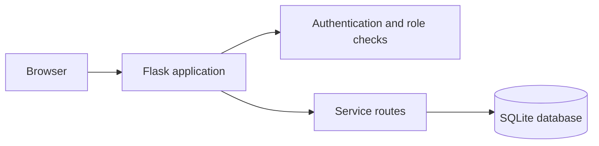
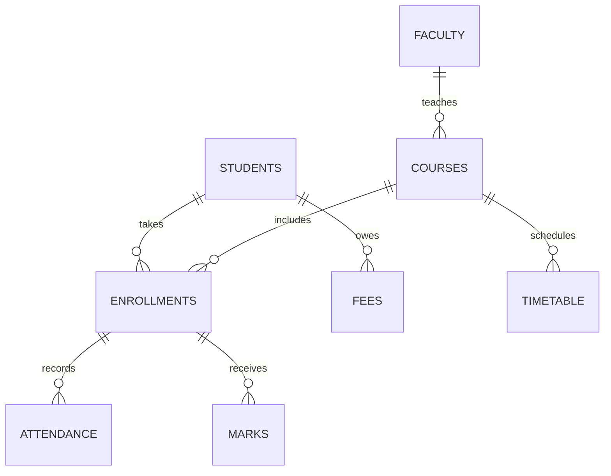

# Student Information System Mini Project Report

## 1. Abstract

Educational institutions need a consistent way to manage student records, course enrollment, attendance, examination marks, fee status and timetables. This project implements a browser-based Student Information System for three roles: Administrator, Faculty and Student. The application uses Flask for server routes, Jinja templates for the user interface and SQLite for persistent relational storage. The implementation follows the UI/UX screens developed for Experiment 10. Role checks apply on the server for all restricted actions.

## 2. Problem Statement

Manual or disconnected record keeping introduces duplicate records, delayed updates and difficulty accessing current academic information. The proposed system centralizes records and gives each role the tools needed for its responsibilities while limiting unauthorized edits.

## 3. Objectives

1. Maintain student, faculty, course and enrollment information in a relational database.
2. Allow assigned faculty to record attendance and examination marks.
3. Allow students to view their own academic and fee information.
4. Provide administrators with fee status management and downloadable reports.
5. Apply password authentication and server-enforced permissions for each role.

## 4. Scope

**Included:** Account sign-in, student/faculty/course management, enrollment, daily attendance, internal and external marks, timetable, fee status, CSV reports and dashboards.

**Excluded:** Payment gateway, online learning, hostel management, mobile app, AI analytics, email delivery and public self-registration.

## 5. Technology Used

| Layer | Technology | Purpose |
| --- | --- | --- |
| Browser interface | HTML, CSS, Jinja | Forms, tables and role-specific navigation |
| Server | Python, Flask | Routing, validation, authentication and authorization |
| Database | SQLite | Persistent records and relational constraints |
| Password storage | Werkzeug password hash | Stores password hashes instead of plain-text passwords |
| Tests | Python unittest and Flask test client | Integration tests of permissions and key user flows |

## 6. Users and Permissions

| Function | Administrator | Faculty | Student |
| --- | --- | --- | --- |
| Manage students, faculty and courses | Yes | No | No |
| Manage enrollments and timetable | Yes | No | No |
| Record attendance and marks | Yes | Assigned courses only | No |
| View student records | Yes | Students in assigned courses | Own profile only |
| View attendance and marks | Yes | Assigned courses | Own records |
| Change fee status and export reports | Yes | No | No |
| View fee status | Yes | No | Own records |

## 7. System Architecture

The browser sends requests to Flask. The server checks the signed session and user role, validates input, and runs parameterized SQL queries. SQLite stores the data. Jinja renders the resulting page for the user's role.

## 8. Database Design

| Table | Purpose | Important relationships |
| --- | --- | --- |
| `users` | Login credentials, role and linked record | `linked_id` identifies the student or faculty record |
| `students` | Student details | Referenced by enrollments and fees |
| `faculty` | Faculty details | Referenced by assigned courses |
| `courses` | Course information | Assigned to a faculty member |
| `enrollments` | Student-course membership | Composite key: student ID + course ID |
| `attendance` | Daily present/absent entry | Student-course enrollment + class date |
| `marks` | Assessment scores | Student-course enrollment + assessment |
| `fees` | Amount, due date and status | Belongs to one student |
| `timetable` | Scheduled class time and room | Belongs to one course |

SQLite foreign keys are enabled for each connection. Primary keys and check constraints reject duplicate attendance entries, invalid roles and out-of-range marks. A corrected attendance record for the same date updates its existing row.

## 9. Main Workflows

### Administrator creates a student account

1. Sign in with an Administrator account.
2. Open **Students** and choose **Add student**.
3. Enter a unique student ID, identity and academic details, and an initial password.
4. The application saves the student and a linked Student login account.
5. Open **Enrollments** and associate the student with a course.

### Faculty records attendance

1. Sign in as Faculty.
2. Open **Attendance** and select an assigned course and class date.
3. Mark each enrolled student Present or Absent.
4. Save; the application stores one entry per student, course and date.
5. Reopen the same date to correct an entry if necessary.

### Faculty publishes marks

1. Select an assigned course on **Examination marks**.
2. Enter internal marks out of 40 and external marks out of 60.
3. Save; the server checks the score ranges before writing.
4. The Student account can then read the total on its Results screen.

### Administrator exports a report

1. Open **Reports** and choose Students, Attendance, Marks or Fees.
2. Review the server-generated preview.
3. Select **Export CSV** to download the same report data.

## 10. Security and Validation

- Passwords are hashed; the database does not store readable passwords.
- User identity is kept in a signed Flask session cookie.
- Every POST form includes a session-based CSRF token.
- Server routes enforce roles; hiding a link alone does not provide access.
- Faculty access to attendance and marks is restricted to courses assigned to that faculty record.
- Student records are selected using the logged-in student's linked ID.
- SQL statements use bound parameters rather than concatenating form values.
- Database constraints enforce uniqueness and score limits.

The bundled demo passwords are intentionally simple so an examiner can test the system locally. Replace them before use with real student records or on a networked deployment.

## 11. Testing

Run `python -m unittest discover -s tests -v` after installing the dependencies. The automated integration tests cover:

| Case | Expected behavior |
| --- | --- |
| Invalid credentials | Login rejected |
| POST without CSRF token | Request rejected |
| Student requests admin page | Access denied |
| Student submits marks or attendance | Access denied |
| Faculty selects an unassigned course | Access denied |
| Faculty records attendance twice on one date | Existing rows updated without duplicates |
| Faculty publishes marks | Student sees the resulting score |
| Administrator creates a student | Linked student account can sign in |
| Administrator exports CSV | Download contains saved student record |

## 12. Result

A functioning, role-based Student Information System was implemented. Records persist in SQLite across server restarts. The three roles can complete their assigned academic workflows through a responsive web interface based on the Experiment 10 design.

## 13. Future Enhancements

For an institutional deployment, add password reset and account management, audit logs, backups, HTTPS, institutional identity integration, pagination for large data sets and automated database migration management. A payment provider should be integrated only if actual online fee collection is required.

## V2 Engineering Improvements

The second version preserves the academic workflows while improving software engineering quality.

1. **Modular support package:** database access, migrations, API endpoints, and administrator tooling are separated into the `sis/` package.
2. **Versioned migrations:** the project maintains a `schema_migrations` history and applies pending schema changes safely.
3. **PostgreSQL deployment:** the production startup path initializes the PostgreSQL schema and applies pending migrations.
4. **REST API:** `/api/v1` exposes role-scoped integration endpoints protected by revocable bearer tokens.
5. **Auditability:** administrators can inspect recent academic changes through `/admin/audit`.
6. **Analytics:** administrators can inspect operational metrics through `/admin/analytics`.
7. **Automated quality checks:** GitHub Actions executes tests, PostgreSQL smoke tests, compilation checks, and linting.
8. **Containerized deployment:** Docker and Docker Compose provide a reproducible Flask + PostgreSQL development environment.

These improvements raise the project from a monolithic academic CRUD application toward a maintainable portfolio-grade software system while keeping institutional production deployment requirements explicit.
